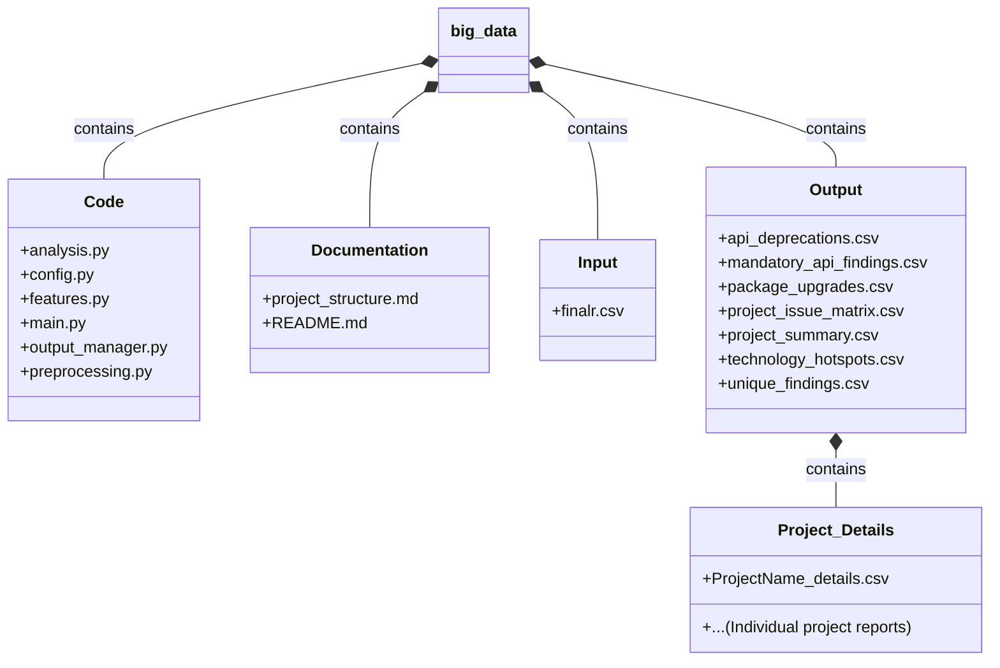
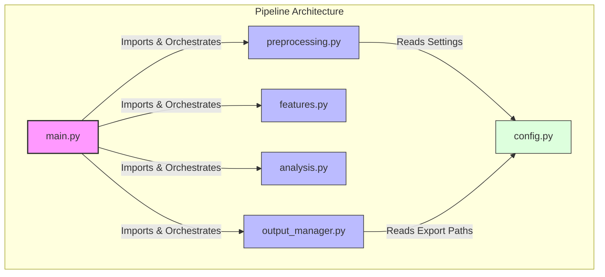
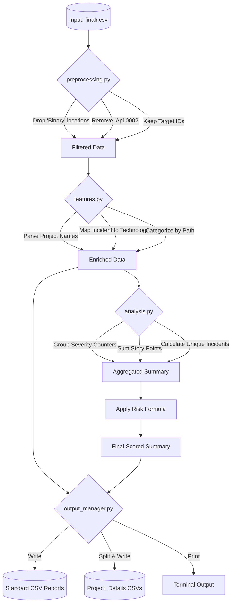
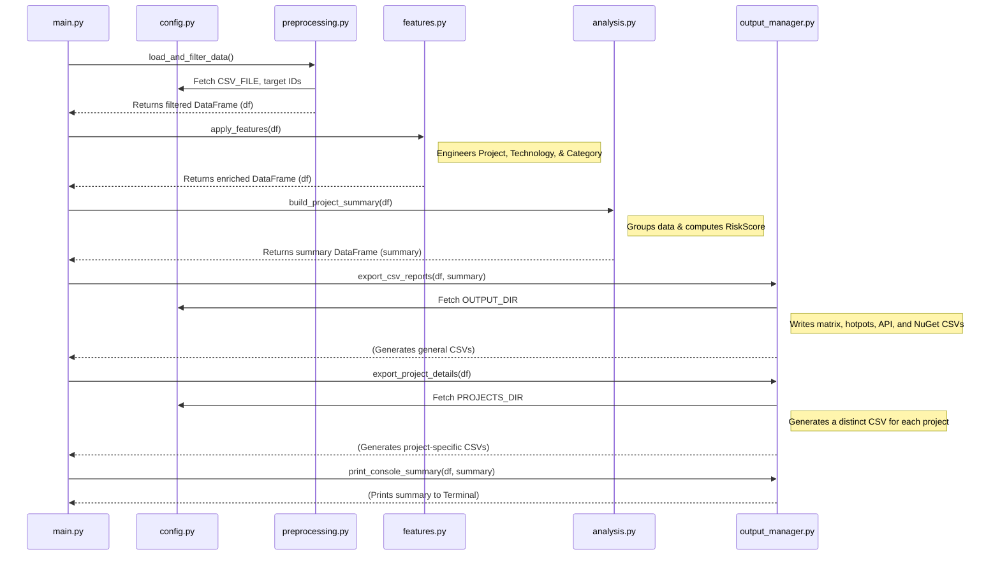

# Project Migration Analysis Pipeline

## Overview

The **Project Migration Analysis Pipeline** is a modular Python-based data processing tool designed to evaluate the readiness of software projects (primarily .NET codebases) for migration or upgrading. 

It ingests raw code analysis findings, sanitizes the data, calculates customizable risk scores, and exports granular reports. These reports help development teams identify migration blockers, isolate deprecated APIs, and plan their migration sprints efficiently.

---

## 📂 Project Structure

The project is organized to separate code, configuration, input data, and generated artifacts cleanly. 



---

## 🧩 Architecture & Modules

The codebase follows the **Separation of Concerns** principle, dividing the data pipeline into single-responsibility modules:

*   **`config.py`**: The universal state. Resolves directory paths dynamically and stores business rules (e.g., target Issue IDs, file paths).
*   **`preprocessing.py`**: Handles data ingestion. Cleans the raw CSV by removing internal binary files and filtering out irrelevant issues.
*   **`features.py`**: The domain logic engine. Parses strings to engineer new columns like "Project", "Technology", and "Category".
*   **`analysis.py`**: The math engine. Groups data, pivots severity counters, calculates unique incidents, and applies the custom `RiskScore` formula.
*   **`output_manager.py`**: Manages side effects. Writes the aggregated dataframes to CSVs in the `Output` folders and prints a terminal summary.
*   **`main.py`**: The orchestrator. Imports the above modules and executes the pipeline in a readable, sequential flow.

### Module Dependencies



---

## 🔄 Data Flow & Execution

The pipeline transforms a raw CSV dump into structured intelligence through a strict top-to-bottom sequence.

### 1. High-Level Activity Flow



### 2. Execution Sequence



---

## 🚀 Getting Started

### Prerequisites
* Python 3.8+
* `pandas` library

Install dependencies using pip:
```bash
pip install pandas
```

### Execution
Ensure your input file (`finalr.csv`) is placed in the `Input` directory, then run the orchestrator script:

```bash
cd Code
python main.py
```

### Outputs
Upon successful execution, the terminal will display a high-level summary. The detailed findings will be generated in the automatically created `Output` folder:
* **`project_summary.csv`**: Master list of all projects and their risk scores.
* **`technology_hotspots.csv`**: Frequencies of specific framework/library issues.
* **`package_upgrades.csv`**: Detailed list of required NuGet updates.
* **`Project_Details/`**: A subdirectory containing isolated, severity-sorted `.csv` files for *every individual project*.